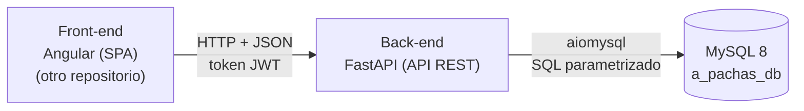

# A Pachas · Back-end

API REST de **A Pachas**, una aplicación web para dividir gastos compartidos: una cena de amigos, un regalo de cumpleaños, un viaje, los gastos de una casa compartida...

Cada usuario puede crear grupos de gastos e invitar a otros usuarios. La app registra quién ha pagado cada gasto, cómo se reparte entre los participantes y las deudas que se saldan, y calcula automáticamente cuánto debe o le deben a cada miembro.

> 🔗 **Este repositorio contiene el back-end** (API REST con FastAPI y la base de datos MySQL).
> El front-end (SPA con Angular) está en **[frontend-proyecto-final](https://github.com/AaronPvon/frontend-proyecto-final)**.

> Los pagos reales (transferencias, Bizum, etc.) se hacen fuera de la aplicación. A Pachas solo los registra y hace las cuentas.

El proyecto se basa en el enunciado **"Compartir gastos"**.

## Estado del proyecto

| Fase | Estado |
|---|---|
| Análisis de requisitos | ✅ Completado |
| Modelo de datos (versión 5) | ✅ Completado y probado en MySQL 8.0 |
| Diseño técnico del back-end | ✅ Completado |
| Fase 1: base y autenticación | ✅ Completada |
| Fase 2: grupos (lectura, permisos y creación) | ✅ Completada |
| Fase 3: invitaciones y miembros | ✅ Completada |
| Fase 4: gastos y repartos | 🚧 En curso: listar y crear gastos |
| Fase 5: liquidaciones | ⏳ Pendiente |
| Fase 6: cierre y reapertura de grupos | ⏳ Pendiente |
| Despliegue | ⏳ Pendiente |

El estado del front-end está en su [repositorio](https://github.com/AaronPvon/frontend-proyecto-final#estado-del-proyecto).

## Funcionalidades

### Requisitos mínimos del enunciado
- Registro e inicio de sesión de usuarios.
- Creación de grupos con título, descripción y presupuesto opcional.
- El creador del grupo invita al resto de usuarios.
- El creador registra los gastos y las liquidaciones, y la app calcula automáticamente lo que debe cada miembro.
- El resto de miembros solo visualizan los gastos, las deudas y los saldos del grupo.

### Funcionalidades previstas para más adelante
- Mensajería asíncrona entre los miembros de un grupo.
- Eliminación de cuenta.
- Simplificación de deudas (mínimo número de transferencias para dejar todos los saldos a cero).
- Recuperación de contraseña y página de perfil.
- Instalación en el móvil como PWA.

## Cómo funciona

### Grupos y miembros
Cualquier usuario registrado puede crear todos los grupos que necesite. El creador es el único que gestiona el grupo: invita a usuarios (buscándolos por email o nickname), registra gastos y liquidaciones, expulsa miembros y cierra o reabre el grupo.

Los usuarios invitados deben aceptar la invitación para entrar en el grupo. A partir de ese momento pueden ver toda su información, pero no modificarla.

### Gastos y repartos
Cada gasto indica quién lo pagó y cómo se reparte. Hay tres modos de reparto:

| Modo | Ejemplo |
|---|---|
| **Iguales entre todos** | Hotel de 300 € entre Ana, Luis y Marta → 100 € cada uno. |
| **Iguales entre algunos** | Entradas de 30 € solo para Luis y Marta → 15 € cada uno. |
| **Personalizado** | Gasolina de 50 € según los kilómetros de cada uno → 10 € + 20 € + 20 €. |

Cuando la división no es exacta, los céntimos sobrantes se reparten de uno en uno empezando por el participante con menor identificador. Por ejemplo, 20 € entre 3 → 6,67 + 6,67 + 6,66.

### Liquidaciones y saldos
Cuando un miembro le paga a otro para saldar una deuda (por ejemplo, con un Bizum), el creador lo registra como una liquidación.

El saldo de cada miembro se calcula con una consulta (nunca se guarda):

```
saldo = lo que ha pagado − lo que le corresponde + liquidaciones enviadas − liquidaciones recibidas
```

Un saldo positivo significa que le deben dinero; uno negativo, que debe dinero. Los saldos de un grupo siempre suman cero.

### Ciclo de vida de grupos y miembros
1. Los grupos nunca se borran. Solo el creador los cierra (con aviso si hay saldos pendientes) y los reabre.
2. El creador nunca sale de sus grupos. Si quiere desentenderse de uno, lo cierra.
3. Un miembro sale del grupo, por voluntad propia o expulsado, solo si su saldo es 0.
4. Las invitaciones pendientes, rechazadas o anuladas se borran.
5. Solo los miembros del grupo lo ven, esté activo o cerrado. Un grupo cerrado es de solo lectura.

## Tecnologías

| Capa | Tecnología |
|---|---|
| Lenguaje | Python 3.13 |
| Framework | FastAPI (API REST) |
| Conexión a la base de datos | aiomysql (pool de conexiones, consultas SQL directas, sin ORM) |
| Autenticación | Tokens JWT con python-jose |
| Hash de contraseñas | Argon2id con argon2-cffi |
| Variables de entorno | python-dotenv |
| Base de datos | MySQL 8 (InnoDB, utf8mb4) |



## Requisitos

- [Python 3.13](https://www.python.org/downloads/)
- [MySQL 8](https://dev.mysql.com/downloads/mysql/) (en local se gestiona con MySQL Workbench)
- Git

## Puesta en marcha

Todos los comandos se ejecutan desde la **raíz del repositorio**.

### 1. Clonar el repositorio

```bash
git clone https://github.com/AaronPvon/backend-proyecto-final.git
cd backend-proyecto-final
```

### 2. Crear el usuario de MySQL

La API se conecta con el usuario `a_pachas_user`. Créalo una sola vez, entrando en MySQL como `root` (desde la terminal con `mysql -u root -p` o desde una pestaña de consultas de MySQL Workbench):

```sql
CREATE USER 'a_pachas_user'@'localhost' IDENTIFIED BY 'cambia_esta_contraseña';
GRANT ALL PRIVILEGES ON a_pachas_db.* TO 'a_pachas_user'@'localhost';
```

En local, este usuario tiene todos los permisos sobre `a_pachas_db`, para que pueda ejecutar el script de creación. En el despliegue solo tendrá permisos de lectura y escritura de datos.

### 3. Crear la base de datos

El script `database/a_pachas.sql` crea la base de datos `a_pachas_db`, sus seis tablas y los datos de prueba.

> ⚠️ El script es para desarrollo: borra las tablas si ya existen y las vuelve a crear, así que se pierden los datos anteriores.

En macOS / Linux (o en el `cmd` de Windows):

```bash
mysql -u a_pachas_user -p --default-character-set=utf8mb4 < database/a_pachas.sql
```

En PowerShell, que no admite la redirección `<`:

```powershell
mysql -u a_pachas_user -p --default-character-set=utf8mb4 -e "source database/a_pachas.sql"
```

También se puede abrir el archivo en MySQL Workbench (*File → Open SQL Script*) y ejecutarlo entero.

> El script empieza con `SET NAMES utf8mb4` y se carga con `--default-character-set=utf8mb4` para que las tildes y la ñ se guarden bien. Sin esto, "García" puede acabar guardado como "García".

Al final, el script muestra el saldo de cada miembro de los grupos de prueba, para comprobar que las cuentas cuadran:

| Grupo | Miembro | Saldo |
|---|---|---|
| Viaje a Lisboa | Ana | +176,66 € |
| Viaje a Lisboa | Luis | −108,33 € |
| Viaje a Lisboa | Marta | −68,33 € |
| Piso compartido | Luis | +10,00 € |
| Piso compartido | Marta | 0,00 € |
| Piso compartido | Pablo | −10,00 € |

### 4. Crear el entorno virtual e instalar las dependencias

```bash
# Windows
py -3.13 -m venv .venv
.venv\Scripts\activate

# macOS / Linux
python3.13 -m venv .venv
source .venv/bin/activate

pip install -r requirements.txt
```

El entorno virtual hay que activarlo en cada terminal nueva antes de arrancar la API.

> `requirements.txt` incluye `python-jose[cryptography]`. El paquete `cryptography` es imprescindible para que aiomysql se autentique en MySQL 8 (`caching_sha2_password`).

### 5. Configurar las variables de entorno

La configuración se lee de variables de entorno, nunca del código. En local se definen en el archivo `.env`, que no se sube al repositorio. Se crea a partir de `.env.example`:

```bash
# Windows
copy .env.example .env

# macOS / Linux
cp .env.example .env
```

Después se rellenan los valores (ver [Variables de entorno](#variables-de-entorno)). La clave de los tokens se genera con:

```bash
python -c "import secrets; print(secrets.token_hex(32))"
```

### 6. Arrancar la API

```bash
uvicorn main:app --reload
```

- API: `http://localhost:8000`
- Documentación interactiva (Swagger): `http://localhost:8000/docs`
- Comprobación rápida: `http://localhost:8000/api/health`

Para probar las rutas privadas en Swagger, haz login con `POST /api/auth/login`, copia el `access_token` y pégalo en el botón **Authorize**.

### 7. Arrancar el front-end

Con la API en marcha, sigue las instrucciones del [repositorio del front-end](https://github.com/AaronPvon/frontend-proyecto-final#puesta-en-marcha). El front-end se sirve en `http://localhost:4200`, que debe figurar en `CORS_ORIGINS`.

## Variables de entorno

| Variable | Ejemplo | Descripción |
|---|---|---|
| `DB_HOST` | `localhost` | Servidor de MySQL. |
| `DB_PORT` | `3306` | Puerto de MySQL. |
| `DB_USER` | `a_pachas_user` | Usuario de MySQL con permisos sobre `a_pachas_db`. |
| `DB_PASSWORD` | | Contraseña de ese usuario. |
| `DB_NAME` | `a_pachas_db` | Nombre de la base de datos. |
| `DB_POOL_MIN` | `1` | Conexiones mínimas del pool. |
| `DB_POOL_MAX` | `10` | Conexiones máximas del pool. |
| `JWT_SECRET_KEY` | | Clave para firmar los tokens. Distinta en cada entorno. |
| `JWT_ALGORITHM` | `HS256` | Algoritmo de firma de los tokens. |
| `JWT_EXPIRE_MINUTES` | `60` | Minutos de validez de cada token. |
| `CORS_ORIGINS` | `http://localhost:4200` | Orígenes permitidos por CORS, separados por comas si hay más de uno. |

## Datos de prueba

Todos los usuarios de prueba tienen la contraseña `Pachas123!`.

| Usuario | Nickname | Email |
|---|---|---|
| Ana García López | `anag` | ana@example.com |
| Luis Martín Sanz | `luism` | luis@example.com |
| Marta Ruiz Fernández | `martar` | marta@example.com |
| Pablo Díaz Moreno | `pablod` | pablo@example.com |

- **Viaje a Lisboa** (activo, creado por Ana): incluye los tres modos de reparto, una liquidación y una invitación pendiente para Pablo.
- **Piso compartido** (cerrado, creado por Luis): Marta saldó su deuda y salió del grupo, y Pablo quedó debiendo 10 €.

## API

Todas las rutas llevan el prefijo `/api`. Las privadas necesitan la cabecera `Authorization: Bearer <token>`. La lista completa, con los datos de entrada y salida de cada ruta, está en Swagger (`/docs`).

### Endpoints

| Método | Ruta | Acceso | Descripción |
|---|---|---|---|
| `GET` | `/api/health` | Pública | Comprueba que la API y la base de datos responden. |
| `POST` | `/api/auth/register` | Pública | Registro de usuario. Responde 201. |
| `POST` | `/api/auth/login` | Pública | Login con email o nickname. Devuelve el token. |
| `GET` | `/api/users/me` | Con sesión | Datos del usuario que ha iniciado sesión. |
| `GET` | `/api/groups?status=active\|closed` | Con sesión | "Mis grupos": grupos en los que el usuario es miembro. |
| `POST` | `/api/groups` | Con sesión | Crea un grupo y añade al creador como miembro. Responde 201. |
| `GET` | `/api/groups/{group_id}` | Miembro | Detalle: datos del grupo, creador, miembros y total gastado. |
| `GET` | `/api/groups/{group_id}/balances` | Miembro | Saldo de cada miembro. |
| `GET` | `/api/groups/{group_id}/invitations` | Miembro | Invitaciones pendientes del grupo. |
| `POST` | `/api/groups/{group_id}/invitations` | Creador | Invita a un usuario por email o nickname (`{"login": "..."}`). Responde 201 con la invitación. |
| `DELETE` | `/api/groups/{group_id}/invitations/{user_id}` | Creador | Anula una invitación pendiente. Responde 204. |
| `POST` | `/api/groups/{group_id}/leave` | Miembro (no el creador) | Salir del grupo, solo con saldo 0. Responde 204. |
| `DELETE` | `/api/groups/{group_id}/members/{user_id}` | Creador | Expulsar a un miembro, solo con saldo 0. Responde 204. |
| `GET` | `/api/invitations` | Con sesión | Invitaciones pendientes del usuario, con el título, la descripción y el creador de cada grupo. |
| `POST` | `/api/invitations/{group_id}/accept` | Invitado | Acepta la invitación y pasa a ser miembro. Responde 204. |
| `DELETE` | `/api/invitations/{group_id}` | Invitado | Rechaza la invitación (se borra). Responde 204. |

Las acciones del creador (invitar, anular y expulsar) y la salida de un miembro solo se permiten con el grupo activo.

### Login

```json
// POST /api/auth/login
{ "login": "anag", "password": "Pachas123!" }

// Respuesta
{ "access_token": "eyJhbGciOi...", "token_type": "bearer" }
```

El campo `login` admite el email o el nickname. El token caduca a los 60 minutos y de momento no hay refresh token.

### Errores

| Código | Cuándo |
|---|---|
| 401 | Falta el token, no es válido o ha caducado. También "Credenciales incorrectas" en el login. |
| 403 | Un miembro que no es el creador intenta gestionar el grupo. |
| 404 | El grupo no existe **o el usuario no es miembro** (no se distingue, para no revelar qué grupos existen). |
| 409 | Email o nickname repetidos, invitación duplicada, grupo cerrado o saldo distinto de 0 al salir o expulsar. |
| 422 | Datos de entrada no válidos. |

### Convenciones
- Los importes viajan en el JSON como texto (`"176.66"`) para que sean exactos. En Python se manejan siempre como `Decimal` y en la base de datos como `DECIMAL(10,2)`.
- Los datos de usuario que se muestran dentro de un grupo son id, nombre, apellidos y nickname. Nunca el email.
- Los permisos se comprueban siempre en la API, en una única función (`core/permissions.py`).

## Base de datos

La base de datos se llama `a_pachas_db` y tiene seis tablas:

| Tabla | Qué almacena |
|---|---|
| `users` | Usuarios registrados y sus datos de acceso. |
| `expense_groups` | Grupos de gastos, con su presupuesto opcional, moneda y estado (activo o cerrado). |
| `group_members` | Relación entre usuarios y grupos, con el estado de cada uno: invitado, miembro o ex miembro. |
| `expenses` | Gastos de cada grupo y quién los pagó. |
| `expense_shares` | Parte de cada gasto que corresponde a cada participante. |
| `settlements` | Liquidaciones entre miembros para saldar deudas. |

El diagrama entidad-relación está en [`database/diagrama_er.mermaid`](database/diagrama_er.mermaid). La descripción detallada de cada tabla y campo está en [`AGENTS.md`](AGENTS.md).

## Estructura del repositorio

```
backend-proyecto-final/
├── README.md
├── AGENTS.md              # documento de referencia del proyecto
├── .env.example           # variables necesarias, sin valores reales
├── .gitignore
├── requirements.txt
├── main.py                # crea la app, CORS, lifespan (pool) y registra las rutas
├── core/
│   ├── security.py        # hash de contraseñas y tokens JWT
│   ├── auth.py            # get_current_user: lee el token de cada petición protegida
│   └── permissions.py     # función única de permisos de grupo
├── db/
│   └── config.py          # pool de conexiones y get_connection
├── models/                # modelos Pydantic de entrada y salida
├── controllers/           # consultas SQL y lógica de negocio
├── routes/                # un fichero por grupo de rutas; llaman al controlador
├── docs/
│   └── Compartir_gastos.pdf   # enunciado del proyecto
└── database/
    ├── a_pachas.sql       # creación de la base de datos con datos de prueba
    └── diagrama_er.mermaid
```

Las rutas no contienen SQL ni lógica de negocio: validan la entrada con los modelos, llaman al controlador y devuelven la respuesta.

## Despliegue

Durante el desarrollo, la API se ejecuta en local, con MySQL 8 en `localhost`. Más adelante se desplegará en un cloud de prácticas, aún por concretar. Las credenciales y URLs irán siempre en variables de entorno.

## Documentación

- [`AGENTS.md`](AGENTS.md): reglas de negocio, permisos, modelo de datos y decisiones tomadas en el back-end.
- [`docs/Compartir_gastos.pdf`](docs/Compartir_gastos.pdf): enunciado del proyecto.
- Front-end: [frontend-proyecto-final](https://github.com/AaronPvon/frontend-proyecto-final).

## Autoría

| | |
|---|---|
| **Autor** | Aarón Pavón Pavón |
| **Curso** | Máster en Desarrollo Web FullStack (febrero - noviembre de 2026) |
